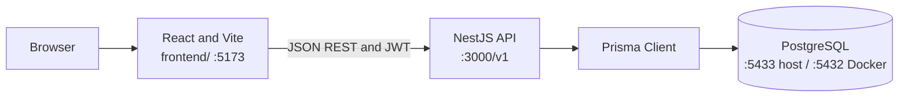
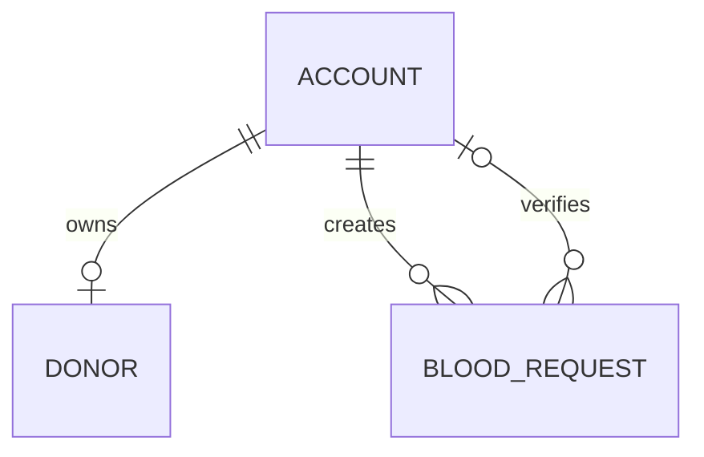

# Blood Donation Registry Architecture and API Overview

This guide describes the current local prototype for frontend developers and contributors. It explains how the web app, API, authentication, database, and matching flow fit together, and lists the API contracts the frontend uses.

## System architecture

The project has three Docker Compose services. The browser loads the separate React/Vite app from port `5173`; the app calls the NestJS REST API on port `3000`; the API uses Prisma to read and write PostgreSQL on port `5433` from the host (port `5432` inside Compose).



The web app is an independent Vite application in `frontend/`; it is not served by NestJS. Its API base URL is `VITE_API_BASE_URL`, defaulting to `http://localhost:3000/v1`. NestJS allows the web origin configured by `WEB_ORIGIN`, defaulting to `http://localhost:5173`.

Start the whole local stack from the project root with `docker compose -f docker/docker-compose.yml up`. Compose starts PostgreSQL, applies Prisma migrations and demo seed data in the API container, starts the API, and runs Vite. The browser addresses are `http://localhost:5173` for the app and `http://localhost:3000/docs` for Swagger.

## Roles and authentication

The API issues a one-hour JWT from `POST /v1/auth/login` or donor registration. Protected requests use `Authorization: Bearer <accessToken>`. Donor routes require the `DONOR` role; creating, verifying, matching, or closing requests requires the `COORDINATOR` role. Public request-list and request-detail routes do not require a token.

Public registration always creates a donor account. It cannot create a coordinator. The local seed creates a coordinator using `COORDINATOR_EMAIL` and `COORDINATOR_PASSWORD`. The demo web UI keeps tokens in memory, so refreshing the page signs both sessions out.

Passwords are stored as bcrypt hashes. Donor phone numbers are encrypted using AES-256-GCM with `DATA_ENCRYPTION_KEY`. The donor can see their own phone in their profile. Matching results, which are coordinator-only, include donor email and phone for coordination. Do not expose those fields in public views or logs.

## Database tables

All primary IDs are PostgreSQL auto-incrementing integers. Prisma schema and migration source live in `prisma/schema.prisma` and `prisma/migrations/`.

### `Account`

Stores login and authorization information.

| Field | Meaning |
|---|---|
| `id` | Auto-incrementing account ID |
| `email` | Unique normalized login email |
| `passwordHash` | bcrypt password hash |
| `role` | `DONOR` or `COORDINATOR` |
| `isActive` | Whether login and matching may use this account |
| `createdAt` | Account creation time |

An account may have one donor profile. Coordinator accounts usually have none.

### `Donor`

Stores the donor profile associated one-to-one with an `Account`.

| Field | Meaning |
|---|---|
| `id` | Auto-incrementing donor ID |
| `accountId` | Unique foreign key to `Account.id`; deleting an account cascades to its donor profile |
| `displayName`, `bloodGroup` | Donor name shown in coordinator match results and blood group |
| `phoneEncrypted` | AES-256-GCM encrypted contact number |
| `area`, `latitude`, `longitude` | Approximate donor location used for distance matching |
| `available` | Donor-controlled opt-in for matching |
| `lastDonationAt` | Optional date used for the prototype eligibility estimate |
| `createdAt`, `updatedAt` | Profile timestamps |

### `BloodRequest`

Stores a need created by a coordinator.

| Field | Meaning |
|---|---|
| `id` | Auto-incrementing request ID |
| `bloodGroup`, `units` | Requested blood group and requested unit count |
| `hospitalName`, `area`, `latitude`, `longitude` | Hospital and request location |
| `urgency` | `ROUTINE`, `URGENT`, or `CRITICAL` |
| `status` | `OPEN`, `FULFILLED`, `CANCELLED`, or `EXPIRED` |
| `verified` | Whether a coordinator has verified the request |
| `expiresAt` | Time after which an open request is expired |
| `createdById` | Required foreign key to the creating coordinator account; deletion is restricted while created requests exist |
| `verifiedById`, `verifiedAt` | Optional verifier account and verification time; deleting that verifier account sets the reference to null |
| `createdAt`, `updatedAt` | Request timestamps |

Matches are calculated on demand and are not stored in a match-history table.



## API reference

All paths are relative to `http://localhost:3000`. The global API prefix is `/v1`. JSON request bodies use `Content-Type: application/json`. Validation rejects unknown fields and invalid enum, date, coordinate, and required values.

### Authentication

| Method and path | Access | Purpose |
|---|---|---|
| `POST /v1/auth/register` | Public | Create a donor account and donor profile; returns a JWT |
| `POST /v1/auth/login` | Public | Verify email/password; returns a JWT |
| `GET /v1/auth/me` | Any valid JWT | Return the current account and safe donor summary, when present |

Registration body:

```json
{
  "email": "donor@example.test",
  "password": "AtLeast10Characters",
  "displayName": "Demo Donor",
  "bloodGroup": "B_POSITIVE",
  "phone": "+910000000001",
  "area": "Kothrud",
  "latitude": 18.5074,
  "longitude": 73.8077,
  "lastDonationAt": "2026-05-01T00:00:00.000Z"
}
```

`lastDonationAt` is optional. The response includes `accessToken`, `tokenType`, `expiresIn`, and a safe `user` object. Login takes `{ "email": "...", "password": "..." }` and returns the same token envelope.

```json
{
  "accessToken": "<JWT>",
  "tokenType": "Bearer",
  "expiresIn": "1h",
  "user": { "id": 12, "email": "donor@example.test", "role": "DONOR" }
}
```

### Donor profile

All donor routes require a donor JWT and operate only on the caller's profile.

| Method and path | Purpose |
|---|---|
| `GET /v1/donors/me` | Read the donor's profile, including their own decrypted phone |
| `PATCH /v1/donors/me` | Change profile, location, availability, phone, or last donation date |
| `GET /v1/donors/me/eligibility` | Return the estimated eligibility and next estimated date |

Example availability update or opt-out from matching:

```json
{ "available": false }
```

To update the last donation date, include `lastDonationAt` as an ISO date-time string. The estimate uses a 56-day interval. A missing date is treated as a first-time donor, who is estimated eligible.

The eligibility response contains `eligible`, `nextEligibleAt`, `reason`, and `rule`. Donor profile responses contain profile fields and the donor's decrypted phone number; do not place that response in shared or public state.

### Blood requests and matching

| Method and path | Access | Purpose |
|---|---|---|
| `GET /v1/blood-requests` | Public | List open, unexpired requests; marks expired open requests as `EXPIRED` |
| `GET /v1/blood-requests/:id` | Public | Get one open, unexpired request |
| `POST /v1/blood-requests` | Coordinator | Create an open, unverified request |
| `POST /v1/blood-requests/:id/verify` | Coordinator | Verify an open request and record verifier/time |
| `POST /v1/blood-requests/:id/matches?maxDistanceKm=50` | Coordinator | Calculate and return matching donor candidates (no contact details) |
| `POST /v1/blood-requests/:id/matches/:donorId/contact` | Coordinator | Release one matched donor's phone and email; each call is audit-logged |
| `POST /v1/blood-requests/:id/fulfill` | Coordinator | Mark an open request fulfilled |
| `POST /v1/blood-requests/:id/cancel` | Coordinator | Cancel an open request |

Create-request body:

```json
{
  "bloodGroup": "B_POSITIVE",
  "units": 2,
  "hospitalName": "City Hospital (Demo)",
  "area": "Shivajinagar",
  "latitude": 18.5204,
  "longitude": 73.8567,
  "urgency": "URGENT",
  "expiresAt": "2026-12-01T12:00:00.000Z"
}
```

Request IDs in paths are integers. Matching requires the request to be open, verified, and unexpired. It filters donors by active account, `available=true`, compatible blood group, a known last donation date at least 56 days old, and distance within `maxDistanceKm` (50 km by default). Distance is straight-line Haversine distance. Results are sorted nearest first and include donor ID, display name, blood group, area, approximate coordinates, rounded distance, and an eligibility estimate. Contact details are not included; the coordinator requests them one donor at a time through the contact endpoint, which is logged.

Match response example:

```json
[
  {
    "donorId": 4,
    "displayName": "Demo Donor",
    "bloodGroup": "B_POSITIVE",
    "area": "Kothrud",
    "distanceKm": 5.4,
    "email": "donor@example.test",
    "phone": "+910000000001",
    "eligibility": "Estimated eligible; must be confirmed with the donor and medical staff."
  }
]
```

Request list/detail/create/verify/close responses include `id`, `bloodGroup`, `units`, hospital and area, request coordinates, urgency, verification state, expiry, and creation time. An empty match result is `[]`.

For a `B_POSITIVE` recipient, the current compatibility map allows `B_POSITIVE`, `B_NEGATIVE`, `O_POSITIVE`, and `O_NEGATIVE` donor groups. The map is a prototype rule and does not replace blood-bank confirmation.

## Frontend flow

1. A donor signs in or registers. Registration creates both `Account` and `Donor` records.
2. The donor checks eligibility and updates availability. Setting `available=false` excludes the donor from future matches without deleting their account.
3. A coordinator signs in using the seeded coordinator account and creates a request. It starts unverified.
4. The coordinator verifies the need, then asks for matches. The frontend should present the returned list in distance order and treat contact details as coordinator-only data.
5. The coordinator contacts a donor outside the app and marks the request fulfilled when enough donors are confirmed, or cancels it if it is no longer needed.

## Current scope and limitations

- There is no account deletion endpoint. Donors can mark themselves unavailable. Coordinator accounts cannot be created through public registration.
- There are no refresh-token, logout-revocation, or persisted match-history APIs. JWTs expire after one hour.
- Matching sorts by distance only; it does not prioritize an exact group over another compatible group, allocate the requested `units` across candidates, reserve donors, or track responses.
- Eligibility is a basic 56-day estimate. It is not medical clearance, and there is no distinct `never donated` status.
- Expiration is applied when active requests are listed or an expired request is processed; there is no background scheduler or reminder system.
- The prototype has no hospital integration or automated donor notifications.
- Public request responses currently include the request coordinates. Use approximate coordinates and avoid putting patient-identifying information in request fields.
