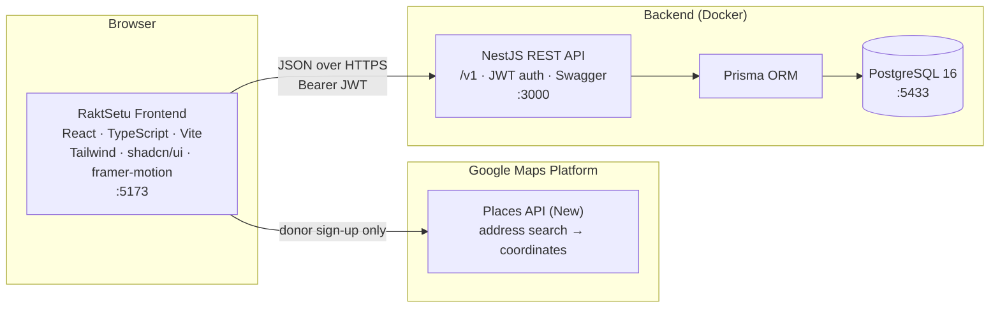
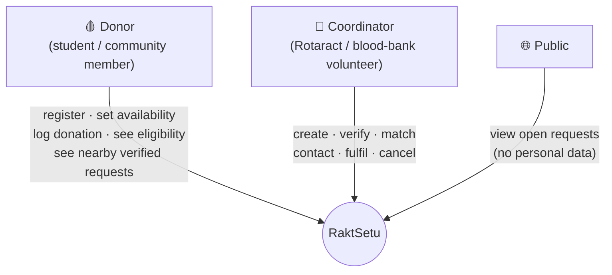
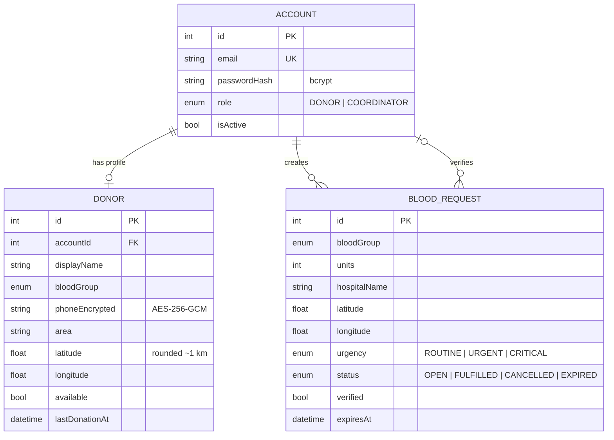
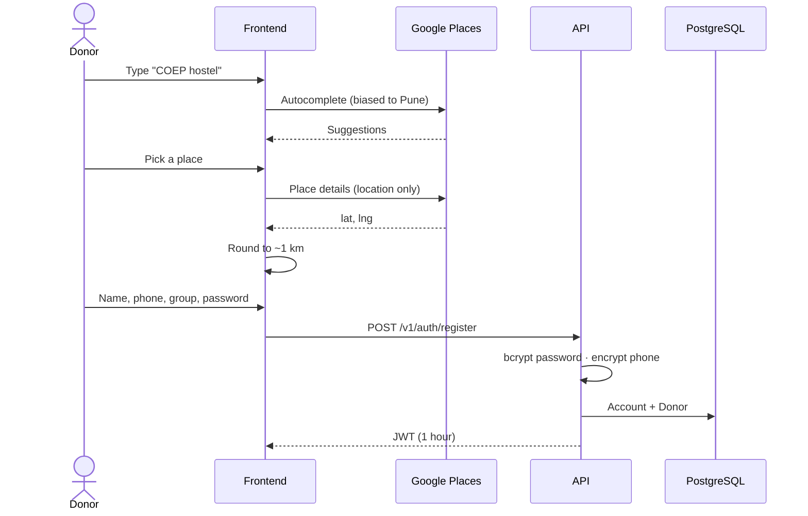
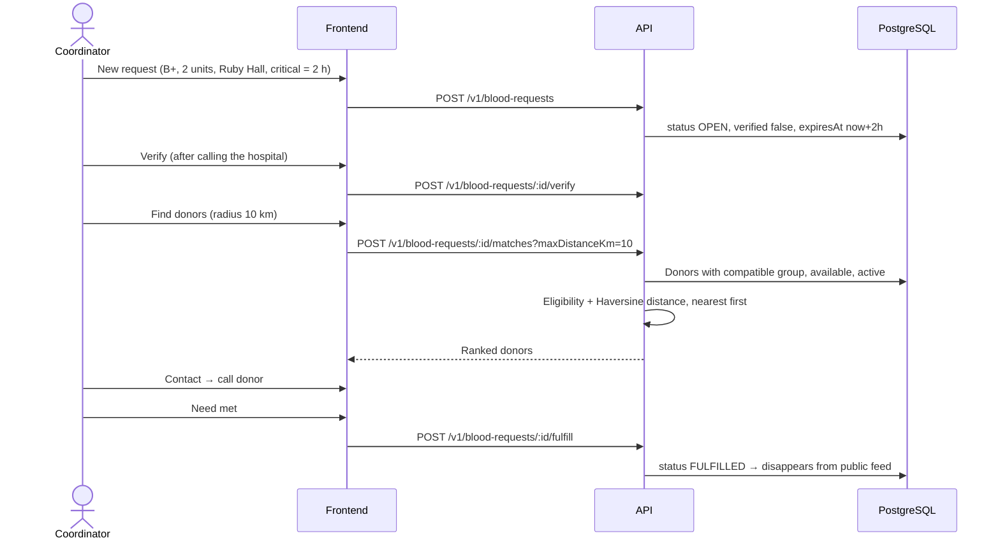
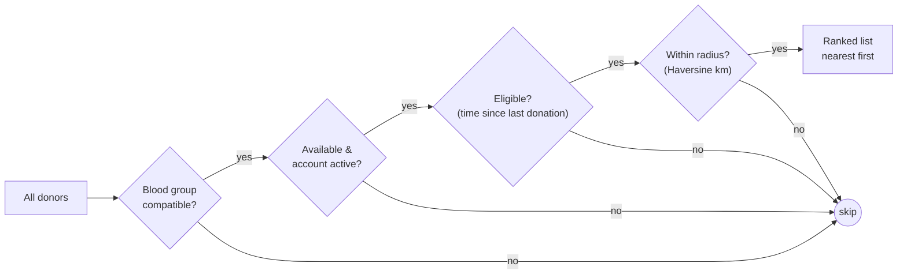
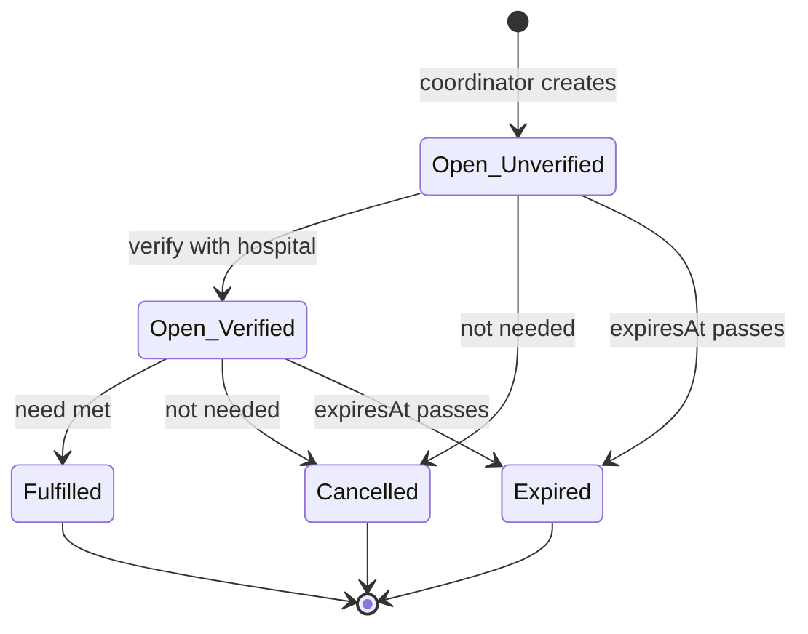

# RaktSetu — Architecture for Demo & Presentation

> **Every drop, to the right place.**
> Naya Bharat 2047 · Code for Bharat · **Problem 2.2 "Urgent: B+ve Needed"** · Healthy Bharat (Rotary Area 2: Disease Prevention & Treatment)

---

## 1. The problem

> *"B+ve blood needed urgently at City Hospital, please share."*

- The message is forwarded hundreds of times — **often long after the need has passed**.
- Willing donors nearby **never see it**, or find out they **aren't eligible** because they donated recently.
- Families scramble for donors at the last minute.

| Fact (from the problem statement) | |
|---|---|
| Blood collected in India, 2024–25 | **~1.46 crore units** — roughly matches national demand |
| Still from last-minute *replacement* donors | **~30%** |
| Drop in donations during summer & festivals | **up to 50%** |

**The gap isn't supply — it's getting the right donor to the right place at the right time.**

## 2. Our idea

RaktSetu (*रक्त सेतु*, "blood bridge") is a **community donor registry with verified, self-expiring requests** that reach **only** the donors who can actually help.

| WhatsApp forward today | RaktSetu |
|---|---|
| Sent to everyone | Sent only to **compatible, available, eligible, nearby** donors |
| Anyone can post, nobody checks | Coordinator **verifies with the hospital** first |
| Lives forever, forwarded for days | **Expires automatically**; closed when the need is met |
| Phone numbers pasted in public groups | Phone numbers **encrypted**; shown only to the coordinator |
| No idea who is eligible | **Eligibility estimate** from last donation date |

---

## 3. System architecture



| Layer | Technology | Responsibility |
|---|---|---|
| Frontend | React 19 + TypeScript, Vite, Tailwind, shadcn/ui, framer-motion | Donor & coordinator apps, animations, address search |
| Location | Google Places API (New) + browser geolocation | Turn an address into coordinates at sign-up (rounded to ~1 km) |
| API | NestJS 11, class-validator, JWT, Swagger | Auth, roles, validation, matching, request lifecycle |
| Data | PostgreSQL 16 via Prisma 6 | Accounts, donor profiles, blood requests |
| Security | bcrypt, AES-256-GCM | Password hashing, phone-number encryption at rest |
| Runtime | Docker Compose (`docker/`) | One command starts DB + API + frontend |

### Repository layout

```
Blood-api/
├── backend/     NestJS API · Prisma schema, migrations, seed
├── frontend/    RaktSetu React app
├── web/         original minimal demo UI (not started by Compose)
└── docker/      docker-compose.yml (db · api · frontend)
```

---

## 4. Users & roles



| Role | How they get access | Can do |
|---|---|---|
| **Donor** | Self sign-up | Manage own profile, pause availability, record donation, view eligibility & matching requests |
| **Coordinator** | Seeded account (never via public sign-up) | Create, verify, match, fulfil and cancel requests; see matched donors' contacts |
| **Public** | No login | View open request summaries — no patient or donor data |

---

## 5. Data model



**Deliberately *not* stored:** patient names, diagnoses, exact home addresses. Matches are computed on demand, not stored.

---

## 6. Key flows

### 6.1 Donor sign-up with location



### 6.2 Request → verify → match → fulfil (the demo flow)



### 6.3 Matching logic



**Compatibility (red cells)** — e.g. a **B+** patient can receive **B+, B−, O+, O−**; **O−** can give to everyone; **AB+** can receive from everyone.

### 6.4 Request lifecycle



Expiry is enforced **every time requests are read**, so a stale request can never be matched or shown — even without a background job.

---

## 7. Privacy & security by design

| Concern | What we do |
|---|---|
| Passwords | bcrypt hash (cost 12); never stored or returned in plain text |
| Phone numbers | AES-256-GCM encrypted at rest; key only in server env |
| Location | Stored to ~1 km; only rounded distance is shown |
| Patient data | Not collected — no names or diagnoses |
| Roles | JWT with role claim; coordinator routes guarded; public sign-up can only create donors |
| Input | Whitelisted, validated DTOs (unknown fields rejected) |
| Secrets | `.env` files git-ignored; frontend only gets a website-restricted browser key |
| Health claims | Eligibility always labelled an **estimate** — final call by donor and blood-bank staff |

---

## 8. Demo script (≈ 3 minutes)

| # | Screen | Say / show |
|---|---|---|
| 1 | **Login** | The stale "Fwd: Fwd: B+ve needed…" messages fade; one calm verified alert replaces them. State the 3 numbers. |
| 2 | **Sign up** as a donor | Search "COEP" → pick address → "saved to about 1 km". Phone is encrypted. |
| 3 | **Coordinator → New request** | B+, 2 units, Ruby Hall, *critical* → auto-expires in 2 h. Starts **unverified**. |
| 4 | **Verify** | "We call the hospital first — no fake urgent requests." |
| 5 | **Find donors** | Radar plots real donors by distance. Drag the radius slider → list updates live. |
| 6 | **Contact** | Number revealed only on purpose. |
| 7 | **Need met** | Request closes and leaves the public feed — no more stale forwards. |
| 8 | **Donor home** | Eligibility ring, availability toggle, "I donated today", nearby verified requests. |

**Demo accounts:** donor `anaya@example.test` / `DonorDemo123!` · coordinator `coordinator@example.test` (password in `backend/.env.local`).

**Run it:** `docker compose -f docker/docker-compose.yml up` → app `http://localhost:5173` · API docs `http://localhost:3000/docs`

---

## 9. Impact

- **Less noise:** a request reaches a handful of matched donors instead of hundreds of group members.
- **No stale alerts:** every request expires or is closed; nothing outlives the need.
- **Faster response:** eligible donors within a few km are found and ranked in seconds, the moment a request is verified.
- **More regular donors:** a registry plus lean-month nudges turns one-time replacement donors into repeat voluntary donors — attacking the ~30% replacement share and the 50% seasonal dip.

---

## 10. Roadmap

| Status | Feature |
|---|---|
| ✅ Built | Donor registry sign-up with address search · JWT roles · verified, self-expiring requests · matching by group, availability, eligibility, distance · encrypted contacts · Docker stack |
| 🔜 Next | **In-app alerts with "I can help / Can't" replies** (contact shared only after a yes) · auto-close when enough donors confirm · **lean-month reminders** · coordinator registry view & college/community field · impact dashboard |
| 🔭 Later | Shareable verified request link (shows "Fulfilled" if forwarded late) · Hindi & Marathi · map view · SMS/WhatsApp alerts · blood-bank stock integration |

### Known limitations (honest slide)

- Eligibility uses a fixed interval and treats donors without a recorded donation as not eligible — being fixed to 90 days and to include first-time donors.
- Match results currently include contact details for coordinators; moving to reveal-on-consent.
- No hospital integration or real notifications in the prototype.

---

*Problem → Idea → Prototype → Impact.* RaktSetu turns a forwarded plea into a verified, targeted, self-closing request.
